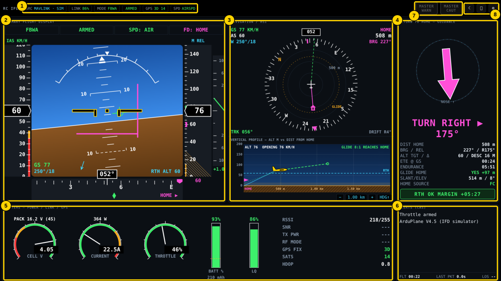

# RC Instrument Flight Display (RC-IFD)

**Fly the instruments, not the video.** RC-IFD turns RC aircraft telemetry into a cockpit-style instrument panel you can use to bring an aircraft home when the video link fails. It runs on Windows, macOS, Linux and Raspberry Pi, reads MAVLink, CRSF or MSP telemetry, logs every flight, and replays it afterwards.

[User Guide](docs/USER_GUIDE.md) · [Quick reference](docs/QUICK_REFERENCE.md) · [Architecture](docs/ARCHITECTURE.md) · [Contributing](CONTRIBUTING.md) · [MIT License](LICENSE)

> [!WARNING]
> RC-IFD is a pilot aid, not certified avionics. It is not a backup for your flight controller's failsafe or return-to-home. Follow local regulations, including visual line-of-sight rules, and always see and avoid manned aircraft.



## Features

- **Primary flight display** — artificial horizon, airspeed/altitude tapes, vertical speed, heading, bank scale, flight-path marker and magenta home-guidance bars.
- **Navigation display** — map-style compass with home pointer, breadcrumb trail, glide ring, wind/ground track, and a vertical profile with a 30-second projection.
- **Return-to-home panel** — large direction arrow, turn instruction, distance, time to home, battery/energy check, glide feasibility, and last-known position with one-tap coordinate copy.
- **Systems and alerts** — battery, current, throttle, link and GPS gauges, plus colour-coded alerts with Master Warning/Master Caution.
- **Waypoint missions** — mission list and map route for MAVLink and INAV (MSP), with active-leg guidance and cross-track error where available.
- **ADS-B traffic** — MAVLink `ADSB_VEHICLE`, local receivers (aircraft.json or SBS-1), and multiple online services running together and merged by ICAO address. Receive-only awareness; you must still give way.
- **Flight logging and replay** — automatic raw logging at the link, standard MAVLink `.tlog` files, JSON summaries, seekable replay with speed control, and disk-space guards.
- **Field-ready links** — serial reconnection after unplug/re-enumeration, DTR/RTS hold for ESP32-style bridges, UDP listen, TCP client with backoff, simulator, and read-only LAN viewers.

## How it works

```text
Flight controller / radio          Python backend (ifd_backend)              Display (web/index.html)
──────────────────────────         ─────────────────────────────            ─────────────────────────
USB-serial / Pi GPIO UART  ──bytes──▶  SerialLink (auto-reconnect)    ──WS──▶  protocol parsers + instruments
UDP (MAVProxy, Wi-Fi)      ──bytes──▶  UdpLink / TcpLink              ◀──WS──  MAVLink requests, MSP polls
TCP (ESP32 bridge, SITL)   ──bytes──▶  Recorder → logs/*.ifdrec, *.tlog, *.json  →  log browser and replay
ADS-B receivers/services   ──JSON────▶  AdsbFeed (merge/deduplicate)   ──WS──▶  traffic symbols and alerts
```

The backend owns the telemetry link and the log. Closing, crashing or reloading the display does not drop the link or stop logging; reopening the display re-attaches to the running backend. With `--lan`, extra phones and tablets are read-only viewers, so MSP is never polled twice and a viewer cannot change the link.

Open `web/index.html` directly without the backend and the display still works in **browser mode** (simulator, Web Serial, WebSocket bridge and replay). Features that need the backend — native windows, serial auto-recovery, automatic flight logging and ADS-B receiver/online feeds — are unavailable in that mode.

## Requirements

| Item | Requirement |
| --- | --- |
| Python | 3.9+ for source installs; the launch scripts create a virtual environment and install `pyserial`. |
| Optional window | `pywebview` for a native window. Without it, Chrome/Edge/Chromium app mode is used; Raspberry Pi prefers Chromium kiosk. |
| Telemetry source | Flight controller or radio sending MAVLink, CRSF or MSP over USB/UART, Wi-Fi bridge (UDP/TCP), or the simulator. |
| Field display | Bright 7–10" screen; Pi 4/5 with a stable 5 V / 3 A+ supply recommended. |

`requirements.txt` contains `pyserial` and an optional `pywebview` dependency (skipped on ARM). The display itself is a single self-contained HTML file using standard browser APIs.

## Install and run

| OS | Steps |
| --- | --- |
| **Windows 10/11** | Install Python 3.9+ from [python.org](https://www.python.org/downloads/), tick **Add python.exe to PATH**, then double-click `run_windows.bat`. The first run creates `.venv` and installs dependencies. |
| **macOS 12+** | Run `./run_mac_linux.sh`. Serial ports appear as `/dev/cu.*`; the `/dev/tty.*` duplicates are hidden. |
| **Linux desktop** | Run `./run_mac_linux.sh`. Once: `sudo usermod -aG dialout $USER`, then copy `deploy/linux/99-rc-ifd.rules` to `/etc/udev/rules.d/` and re-login. |
| **Raspberry Pi 4/5** | Run `bash deploy/raspberrypi/install_pi.sh` and reboot once. See [the user guide](docs/USER_GUIDE.md#raspberry-pi-field-unit) for details. |
| **Packaged build** | Install the `.dmg`/`.app` (macOS) or the built executable folder (Windows/Linux). Build your own with `python build_standalone.py` on the target OS. |

From a source checkout, the launchers pass all arguments through:

```bash
./run_mac_linux.sh --fullscreen
# or, on Windows:
run_windows.bat --kiosk
```

Useful options:

| Option | Effect |
| --- | --- |
| `--port N` | Local UI port (default `8765`; the server tries the next free port if taken). |
| `--lan` | Serve the display on all interfaces for read-only viewers at `http://<computer-ip>:8765/`. |
| `--data-dir PATH` | Store settings and logs elsewhere, e.g. a USB drive. `RC_IFD_DATA` is also honoured. |
| `--window auto\|webview\|chromium\|browser\|none` | Choose the window type; `auto` prefers pywebview on desktops and Chromium kiosk on Pi. |
| `--fullscreen`, `--kiosk` | Full-screen window; kiosk hides window chrome. |
| `--headless` | Backend only (same as `--window none`) for the Pi logging service. |
| `--keep-running` | Keep the backend and logging alive after the window closes. |
| `--max-log-mb N`, `--min-free-mb N` | Log retention limits (defaults `2000` and `300`). |
| `--quiet`, `--version` | Less console output; print version and exit. |

Run `python rc_ifd.py --help` for the full list.

## Telemetry connections

Configure these in **Settings → Connection** (⚙ in the top bar).

| Protocol | Typical source | Common baud | Notes |
| --- | --- | --- | --- |
| MAVLink | ArduPilot, PX4, telemetry radio, SITL | 57600 / 115200 | Two-way requests for home, streams and missions; can be set listen-only. |
| CRSF | ExpressLRS, Crossfire receiver telemetry | 420000 (try 416666) | UART telemetry only; no wind or mission data. |
| MSP | INAV, Betaflight | 115200 | App polls the flight controller; USB ignores baud. Betaflight has no missions. |

| Transport | Use it for |
| --- | --- |
| Serial | USB flight controller, USB-UART adapter, CRSF tap, Pi `/dev/serial0`. Ports are labelled with USB name and VID:PID; **Hold DTR/RTS low** prevents ESP32/Arduino resets. |
| UDP | MAVProxy `--out`, mavlink-router, Wi-Fi backpacks, SITL. Listens on a port and replies to the last sender. |
| TCP client | ESP32 bridges (`192.168.4.1:5760`), SITL, mavlink-router. Reconnects with backoff. |
| Simulator | Built-in aircraft and six-waypoint mission for bench testing. |
| Replay | Any logged flight, with seek and speed control. |
| Live (view) | Read-only LAN viewer on a second device. |

## Flight logs

A new log starts when telemetry arrives. Sessions split after 60 seconds without data, and very short bench connections are discarded. **● Log now** forces a recording.

| File | Contents |
| --- | --- |
| `*.ifdrec` | Exact timestamped byte stream for every protocol; used by replay. |
| `*.tlog` | Standard MAVLink log, opens in Mission Planner, MAVExplorer, QGroundControl and pymavlink. |
| `*.json` | Sidecar with protocol, link, start/end, arm/mode events and warnings. |

| Platform | Data folder |
| --- | --- |
| Windows | `%LOCALAPPDATA%\RC-IFD` |
| macOS | `~/Library/Application Support/RC-IFD` |
| Linux / Pi | `~/.local/share/rc-ifd` |

Logs live in the `logs/` subfolder. Data is flushed every second and synced every five seconds, so a sudden power cut loses at most about five seconds; interrupted logs are marked *recovered* and remain replayable. Oldest logs are pruned above the configured total size or when free space runs low.

## Repository layout

```text
.
├── LICENSE                 # MIT license
├── README.md               # this file
├── CONTRIBUTING.md         # development and test notes
├── docs/
│   ├── USER_GUIDE.md       # full operating manual
│   ├── QUICK_REFERENCE.md  # one-page field card
│   ├── ARCHITECTURE.md     # technical overview
│   └── images/             # figures from the user guide
├── ifd_backend/            # links, recorder, ADS-B feed, HTTP/WebSocket server, window handling
├── web/index.html          # self-contained display UI
├── tests/                  # backend, ADS-B and protocol-engine tests
├── tools/telemetry_sim.py  # stand-in MAVLink aircraft
├── deploy/                 # Linux udev rule and Raspberry Pi installer/service
├── rc_ifd.py               # application launcher and CLI
├── build_standalone.py     # optional PyInstaller build
└── run_mac_linux.sh, run_windows.bat
```

## Development

```bash
python tests/test_backend.py      # framer, recorder, server, UDP link, serial unplug/re-enumeration
python tests/test_adsb.py         # multi-source ADS-B parsing, merging and backoff
node   tests/ifd_engine_tests.js  # MAVLink/CRSF/MSP codecs and corruption resync
python tools/telemetry_sim.py --udp 127.0.0.1:14550
```

The backend tests use pseudo-terminals and a fake pyserial for serial replay tests on POSIX. To build a standalone app, install PyInstaller and run `python build_standalone.py` on each target OS (PyInstaller does not cross-compile). See [CONTRIBUTING.md](CONTRIBUTING.md) before making changes.

## License

Released under the [MIT License](LICENSE). Third-party runtime dependencies retain their own licenses.
