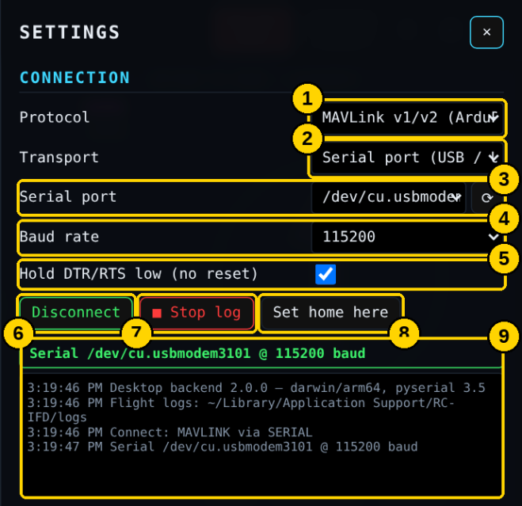
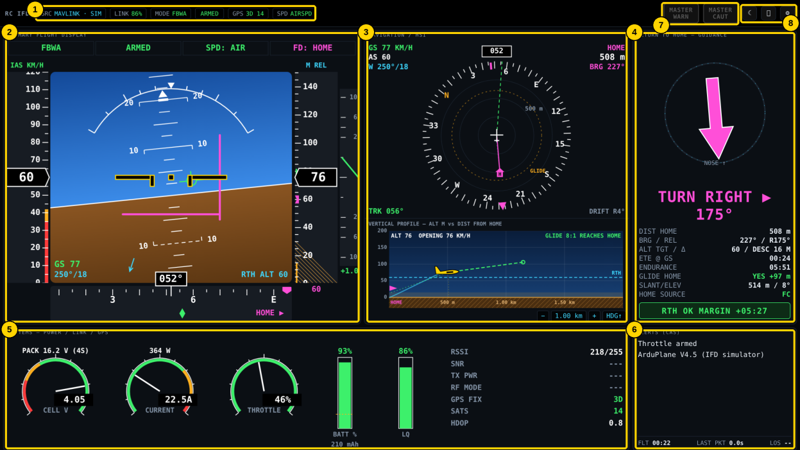
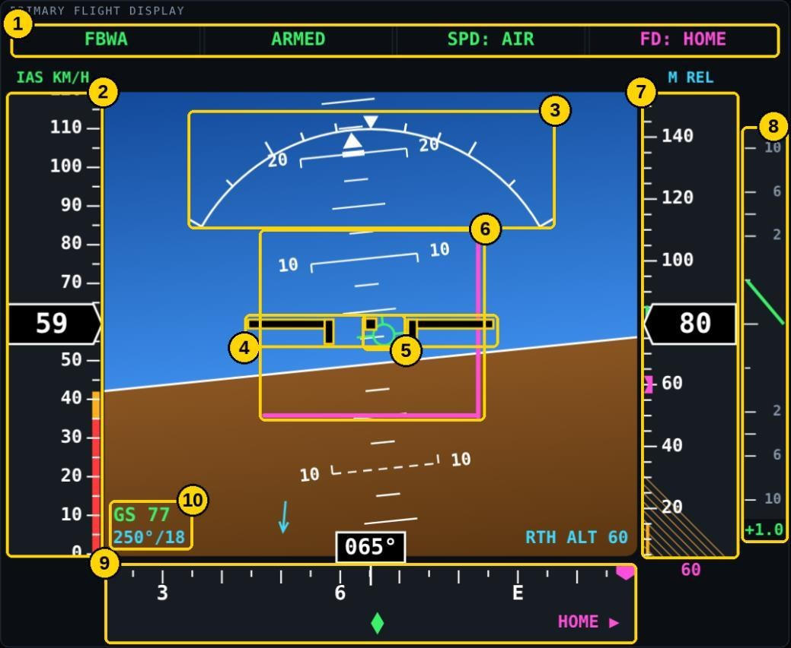
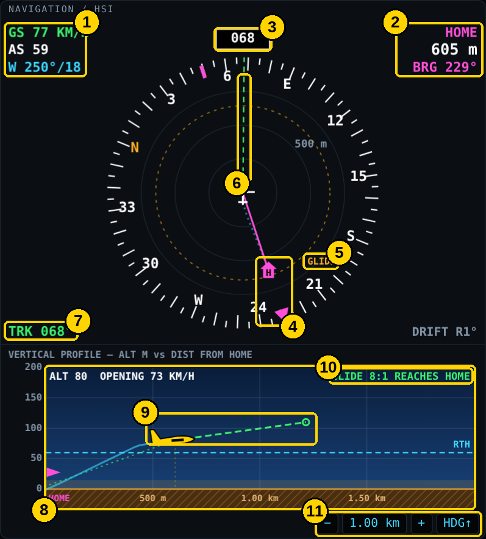
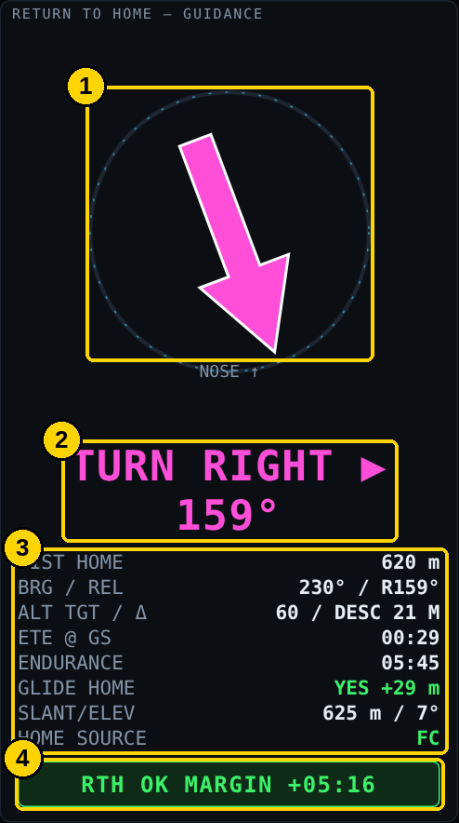
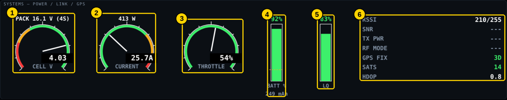
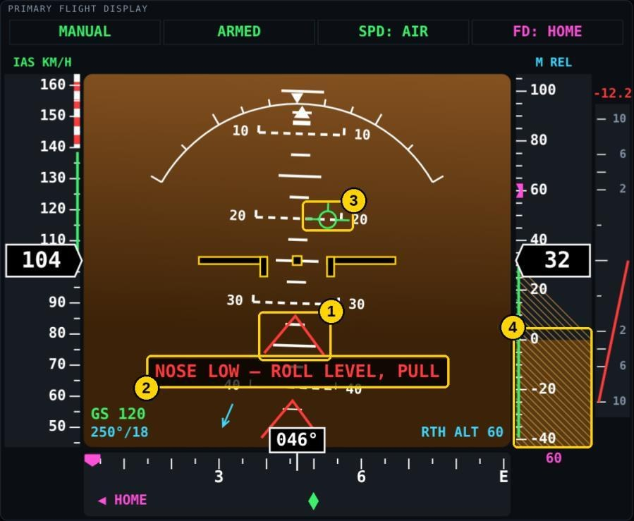
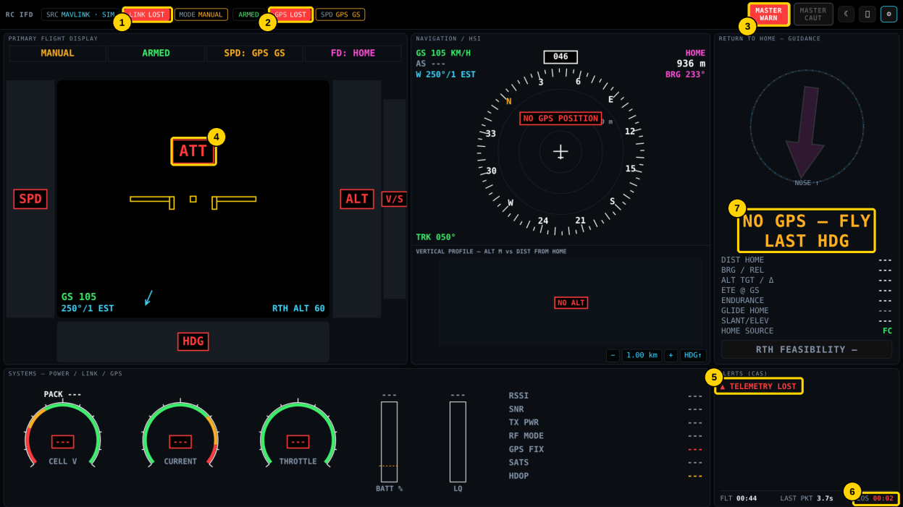
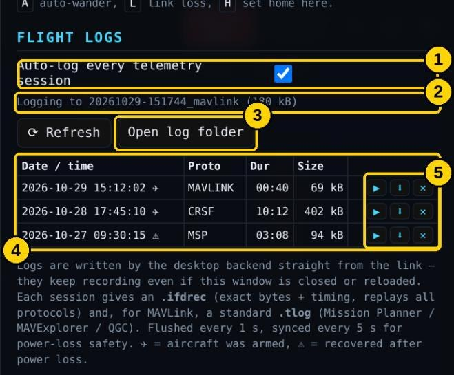
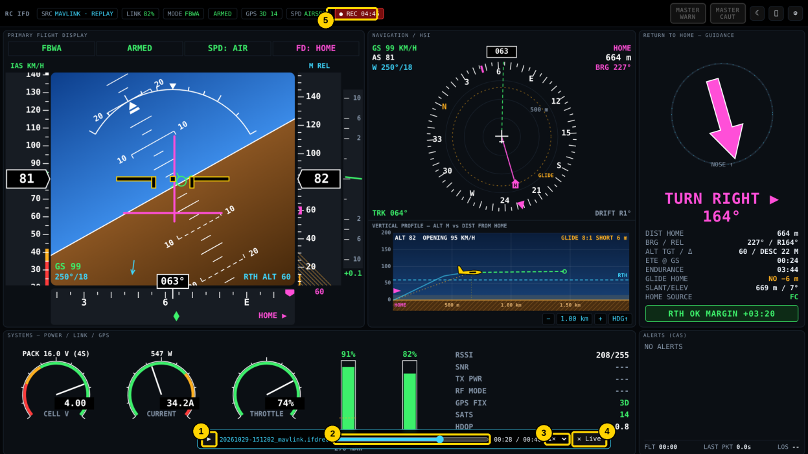

# RC Instrument Flight Display — User Guide

RC-IFD turns aircraft telemetry into a flight deck you can use to bring an RC aircraft home when video fails. It reads MAVLink, CRSF or MSP data, draws the instruments, logs every flight, and replays it later.

> [!WARNING]
> This is a pilot aid, not certified avionics. It is not a substitute for visual line-of-sight, your flight controller's failsafe, or a spotter. Configure the flight controller's own return-to-home first, and never rely on this display as your only backup.

Screenshots in this guide illustrate the instrument panels and controls. Small layout and label differences between screenshots and the current display are normal.

## Contents

- [1. Before you start](#1-before-you-start)
- [2. Install and launch](#2-install-and-launch)
- [3. Modes and start-up options](#3-modes-and-start-up-options)
- [4. Connect to the aircraft](#4-connect-to-the-aircraft)
- [5. The screen at a glance](#5-the-screen-at-a-glance)
- [6. Fly home on instruments](#6-fly-home-on-instruments)
- [7. Recovery and failure indications](#7-recovery-and-failure-indications)
- [8. Waypoint missions](#8-waypoint-missions)
- [9. ADS-B traffic](#9-ads-b-traffic)
- [10. Flight logs and replay](#10-flight-logs-and-replay)
- [11. Settings reference](#11-settings-reference)
- [12. Troubleshooting](#12-troubleshooting)
- [13. Share an install](#13-share-an-install)
- [Quick reference card](QUICK_REFERENCE.md)

---

## 1. Before you start

### What the display gives you

- Artificial horizon with speed and altitude tapes, vertical speed, heading tape and magenta steering bars that point home.
- Moving map with home pointer, glide-range ring, breadcrumb trail, and a side-view profile of the aircraft above the ground.
- Return-to-home panel with a large direction arrow, turn instruction, distance, time to home and a battery check.
- Battery, current, throttle, link quality and GPS gauges, plus a colour-coded alert list with Master Warning/Master Caution.
- Waypoint missions on the map and in a list (MAVLink and INAV).
- ADS-B traffic from the flight controller, a local receiver, or online services, with collision-style symbols and alerts.
- Automatic flight logging with seekable replay and a standard `.tlog` for Mission Planner and other tools.
- Home and aircraft coordinates in several formats, with one-tap copy and a last-known position that survives an app restart.

### Colour conventions

The same colours mean the same thing everywhere, as in a real cockpit.

| Colour | Meaning |
| --- | --- |
| White | Scales and current values |
| Green | Normal, active or within limits |
| Magenta | Guidance and home — steer towards magenta |
| Cyan | Values you have set (return altitude, wind, trail, profile line) |
| Amber | Caution — needs attention soon |
| Red | Warning or failed data. A red boxed label (`ATT`, `SPD`, `ALT`, `V/S`, `HDG`) means that instrument has no valid data — do not use it. |

### What you need

| Item | Requirement |
| --- | --- |
| Computer | Windows 10/11, macOS 12+ (matching Intel or Apple Silicon build), Linux desktop, or Raspberry Pi 4/5 with 64-bit Raspberry Pi OS recommended. |
| Telemetry source | Flight controller or radio sending MAVLink, CRSF or MSP via USB, USB-UART, the Pi GPIO UART, or a Wi-Fi bridge. |
| Screen | A bright, sunlight-readable display; 7–10" works well on a Pi. |
| Power | Stable 5 V / 3 A+ for a field Pi — brown-outs during radio transmit cause resets. |
| Software | Packaged app: nothing else. Source folder: Python 3.9+; the launchers install `pyserial` and optionally `pywebview`. |

### Recommended telemetry settings

| Protocol | Typical source | Baud | Notes |
| --- | --- | --- | --- |
| MAVLink | ArduPilot/PX4 telemetry port or USB | 57600 / 115200 | Match `SERIALx_BAUD`; USB ignores baud. |
| CRSF | ExpressLRS / Crossfire receiver telemetry | 420000 | Try 416666 if the adapter rejects 420000. |
| MSP | INAV / Betaflight USB or UART with MSP enabled | 115200 | The app polls the controller; the port must be set to MSP. |

---

## 2. Install and launch

### Packaged app

If you were given a packaged build:

- **macOS:** open the `.dmg`, drag RC-IFD into Applications, then right-click → **Open** on first launch. If macOS reports the app as damaged, run `xattr -dr com.apple.quarantine /Applications/RC-IFD.app` once in Terminal. Get a build that matches your Mac (Apple menu → About This Mac).
- **Windows:** unzip the RC-IFD folder somewhere permanent and double-click `run_windows.bat`. Windows usually installs USB serial drivers automatically; CH340 adapters may need the WCH driver.
- **Linux / Pi:** use the source folder as described below.

### From the source folder

| OS | Steps |
| --- | --- |
| Windows | Install Python 3.9+ with **Add python.exe to PATH**, then double-click `run_windows.bat`. |
| macOS | Run `./run_mac_linux.sh` from a terminal. |
| Linux desktop | Run `./run_mac_linux.sh`. Once: `sudo usermod -aG dialout $USER`, then copy `deploy/linux/99-rc-ifd.rules` to `/etc/udev/rules.d/`, reload udev and re-login. |
| Raspberry Pi | `bash deploy/raspberrypi/install_pi.sh`, then reboot once. |

The first run creates `.venv` and installs dependencies. Later runs start immediately.

### Raspberry Pi field unit

`deploy/raspberrypi/install_pi.sh` sets up:

- `python3-venv`, `python3-serial` and Chromium.
- `dialout` membership and the udev rule that keeps ModemManager away from flight controllers.
- A **systemd user service** (`rc-ifd.service`) that starts the backend at boot and keeps logging with no screen attached.
- A full-screen **Chromium kiosk** at login. Exit with Alt+F4.
- A 30 fps display cap on first run (Settings → Display) to reduce heat and power use.

To use the Pi's own UART (GPIO14/15), run `sudo raspi-config` → Interface Options → Serial Port, answer **No** to the login shell and **Yes** to the hardware port, then select `/dev/serial0` in Settings.

### Where data is stored

| Platform | Folder |
| --- | --- |
| Windows | `%LOCALAPPDATA%\RC-IFD` |
| macOS | `~/Library/Application Support/RC-IFD` |
| Linux / Pi | `~/.local/share/rc-ifd` |

Settings (`settings.json`) and logs (`logs/`) live there. Override the folder with `--data-dir PATH` or the `RC_IFD_DATA` environment variable — useful for writing logs to a USB drive.

---

## 3. Modes and start-up options

### Desktop backend (recommended)

`rc_ifd.py` starts the Python backend and shows the display in a native-feeling window. The backend owns the link and the log: closing or reloading the window does not stop logging. Starting the app again while it is already running opens another window onto the existing backend instead of competing for the serial port.

### Browser mode

Opening `web/index.html` directly still gives you a working display using the Simulator, USB/Web Serial, a WebSocket bridge or a local replay file. Without the backend there is no automatic logging, no serial auto-recovery, and no ADS-B receiver or online feed.

### Extra displays and headless logging

- Start with `--lan` and open `http://<computer-ip>:8765/` on a phone or tablet. Only the first local window controls the link; other screens are read-only so MSP is never polled twice.
- `--headless` runs only the backend and is what the Pi service uses. The UI remains available at the local URL if you want to open it.
- `--keep-running` keeps the backend alive after the window closes.

The server binds to localhost by default. `--lan` binds to all interfaces but has no authentication — use it only on a trusted network.

### Command-line options

| Option | Effect |
| --- | --- |
| `--port N` | UI port, default `8765` (next free port used if occupied). |
| `--lan` | Allow read-only viewers on the local network. |
| `--data-dir PATH` | Store settings and logs elsewhere. |
| `--window auto\|webview\|chromium\|browser\|none` | Force a window type. |
| `--fullscreen` | Start full-screen. |
| `--kiosk` | Full-screen with no window controls. |
| `--headless` | Backend only. |
| `--keep-running` | Keep backend/logging after the window closes. |
| `--max-log-mb N` | Prune oldest logs above this total (default `2000`). |
| `--min-free-mb N` | Keep this much disk free (default `300`). |
| `--quiet` | Suppress console logging. |
| `--version` | Print version and exit. |

---

## 4. Connect to the aircraft

Open Settings with the ⚙ button in the top bar.

| # | Control | What it does |
| --- | --- | --- |
| 1 | Protocol | MAVLink, CRSF or MSP — must match what the aircraft sends. |
| 2 | Transport | Serial port, UDP, TCP client, Simulator or Replay. |
| 3 | Serial port + ⟳ | Ports are listed with device name and USB ID. Press ⟳ after plugging in. |
| 4 | Baud rate | See the table in section 1. Changing it reconnects automatically. |
| 5 | Hold DTR/RTS low | Leave ticked. Stops ESP32/Arduino bridges resetting when the port opens. |
| 6 | Connect / Disconnect | Opens or closes the link. A failed attempt changes the button to **Retry**; changing the port, baud or address retries automatically. |
| 7 | Log now / Stop log | Manual recording control. Normally not needed — logging starts automatically. |
| 8 | Set home here | Makes the current aircraft position home. Asks for confirmation if armed. |
| 9 | Status and log | Green means connected and receiving. Below it: detected vehicle type, log folder and any errors. |

### First connection

1. Power the aircraft and connect the telemetry source to the computer.
2. Open Settings (⚙).
3. Choose Protocol and Transport, then the serial port and baud rate (or UDP port / TCP host and port).
4. Click **Connect**. The status line turns green and the instruments come alive within a few seconds.
5. Do the bench check below before the first flight with each aircraft.

**UDP:** the app listens on the port you enter (14550 by default). Point MAVProxy, mavlink-router or your Wi-Fi bridge at the computer's IP and that port. Replies go to the last sender.

**TCP:** enter `host:port`, for example `192.168.4.1:5760` for a typical ESP32 bridge. Connection attempts back off automatically when the bridge is unavailable.

### Bench check (once per aircraft)

1. Lift the nose: the horizon line must move **down**.
2. Roll right: the horizon must tilt **left** (anticlockwise).
3. If either is wrong, tick **Invert pitch** or **Invert roll** under Protocol options. These are saved separately for each protocol.
4. Check **HOME SOURCE** in the return-to-home panel shows `FC` or `ARM POINT` before take-off.

### When the link misbehaves in the field

- **Unplug or brown-out:** the backend reports *lost*, then re-opens the same adapter. It matches by device path first, then USB VID:PID and serial number, because Windows may assign a new COM number and Linux/macOS may rename the device.
- **Port already in use:** ports are opened exclusively on Linux/macOS so a configurator or GCS cannot silently share the data. You get a clear "in use / busy" message.
- **Clear errors:** permission problems, missing CH340/CP210x drivers, and unsupported baud rates each produce a specific message.
- **ModemManager:** on Linux it probes new USB serial devices and corrupts the start of the stream. The shipped udev rule stops it.

---

## 5. The screen at a glance

| # | Area | What it tells you |
| --- | --- | --- |
| 1 | Status bar | Telemetry source, link quality, flight mode, armed state, GPS fix and satellites, speed source, `● REC` when logging, and `TFC` count (amber/red when traffic is a threat). |
| 2 | Primary flight display | Attitude, speed, altitude, climb/sink and heading — your main instrument. |
| 3 | Navigation display | Compass/map with home, trail and glide range, plus the vertical profile. |
| 4 | Return-to-home panel | Which way and how far to home, whether the battery will get you there, and home/aircraft coordinates. |
| 5 | Systems | Battery, current, throttle, link and GPS health. |
| 6 | Alerts panel | Tabbed panel: ALERTS, MISSION and TRAFFIC, with flight time and link-loss timers. |
| 7 | Master Warning / Caution | Flash when a new warning or caution appears. Tap to acknowledge. |
| 8 | Top-bar buttons | Moon switches to a red night palette; full-screen button or F11 fills the screen (Esc exits); ⚙ opens Settings (Esc closes). |

Top-bar labels turn amber or red when something is degraded. A red `LINK LOST` or `GPS LOST` is the first thing to check if the display seems frozen.

### 5.1 Primary flight display

| # | Element | Meaning |
| --- | --- | --- |
| 1 | Mode strip | Flight mode, armed state, speed source (`AIR` = airspeed sensor, `GPS GS` = ground speed) and `FD: HOME` when guidance is active. |
| 2 | Speed tape | Current speed in the box. Red band below stall, amber near stall, red/white above never-exceed. Green line shows speeding up or slowing down. |
| 3 | Bank scale | Bank angle in degrees; pointer turns amber beyond the configured limit (55° by default). |
| 4 | Aircraft symbol | The yellow wings. Where they sit against the horizon is the aircraft's attitude. |
| 5 | Flight-path marker | Green circle with wings: where the aircraft is actually going, including wind drift and climb/sink. Below the horizon means descending, whatever the nose is doing. |
| 6 | Magenta steering bars | Fly the yellow aircraft symbol onto the cross: vertical bar steers towards home, horizontal bar towards the return altitude. |
| 7 | Altitude tape | Height above home. Magenta marker is return altitude; amber strip is the low-altitude zone; hatched area is below home level. |
| 8 | Vertical speed | Climb or sink rate; amber then red for steep descents. |
| 9 | Heading tape | Heading in the box. Green diamond is actual ground track; magenta marker is home (`◀ HOME` / `HOME ▶` when off-scale). |
| 10 | Ground speed and wind | GS and wind direction/speed with an arrow. `EST` means the app estimated the wind. |

### 5.2 Navigation display and vertical profile

| # | Element | Meaning |
| --- | --- | --- |
| 1 | Speeds and wind | Ground speed, airspeed and wind. |
| 2 | Home data | Distance and bearing to home. |
| 3 | Heading | Current heading, or `N-UP` in north-up mode. |
| 4 | Home pointer | Magenta `H` and line to home, with a compass-ring pointer even when home is off the map. |
| 5 | Glide ring | Amber dashed circle: how far the aircraft could glide with the motor stopped. |
| 6 | Track line | Green dashed line: actual movement over the ground. |
| 7 | Track and drift | Ground track and wind drift left/right (amber above 15°). |
| 8 | Vertical profile | Side view: distance from home left-to-right, height up. Blue is recent path, cyan dashed is return altitude, ground is home elevation (no terrain data). |
| 9 | Aircraft and projection | Aircraft symbol faces home; dashed line shows where you will be in 30 seconds, turning red with an X if that is the ground. |
| 10 | Glide result | `REACHES HOME` or `SHORT` by a distance, using the configured glide ratio. |
| 11 | Range and orientation | `−` / `+` change map scale; `HDG↑` / `N↑` switch heading-up and north-up. |

Traffic symbols are overlaid on this display when an ADS-B source is enabled. Auto-range can zoom the map out to show alerting traffic; the range label turns amber and shows `TFC`.

### 5.3 Return-to-home panel

| # | Element | Meaning |
| --- | --- | --- |
| 1 | Home arrow | Points to home relative to the nose; straight up means home is ahead. |
| 2 | Turn instruction | Which way and how far to turn. Turns green with `HOME AHEAD — HOLD`, then `OVERHEAD HOME`. |
| 3 | Home data | Distance, bearing, climb/descend to return altitude, time to home, battery endurance, glide result, straight-line distance/angle for pointing a ground antenna, and home source. |
| 4 | RTH feasibility | `RTH OK` (green), `RTH MARGINAL` (amber, about a minute spare) or `CANNOT REACH HOME — LAND NOW` (red, flashing). |

**HOME SOURCE** shows `FC` when home comes from the flight controller. `ARM POINT`, `FIRST FIX` or `MANUAL` means the app set home itself — check it is where you launched.

#### Positions and last-known position

Below the home data you can find the aircraft if it comes down out of sight.

| Item | Meaning |
| --- | --- |
| `CRAFT FROM HOME` | Bearing and distance from home to the aircraft — the direction to walk. |
| `ALT MSL / REL` | Altitude above sea level and above home. |
| Home row (magenta) | Home latitude and longitude. |
| Aircraft row | Live aircraft latitude and longitude while GPS is fresh. |
| `LKP mm:ss` (amber) | If link or GPS drops, the aircraft row keeps the last known position and shows its age. Refreshed every 2 seconds and kept in browser storage across restarts. |
| Format button (`DD`) | Cycles decimal degrees (DD), degrees + decimal minutes (DDM) and degrees-minutes-seconds (DMS). |
| Click a row | Copies `lat, lon` (7 decimal places) for pasting into a maps app. |

Clear an old saved position with **Settings → Clear saved last-known position**. The value is per browser profile.

### 5.4 Systems

| # | Element | Meaning |
| --- | --- | --- |
| 1 | Cell voltage | Average volts per cell with pack voltage above; amber/red zones follow the configured thresholds. |
| 2 | Current | Amps drawn, with watts above. |
| 3 | Throttle | Throttle percentage when the protocol provides it. |
| 4 | Battery % | Remaining capacity; dashed amber line is your landing reserve. |
| 5 | LQ | Radio link quality — amber below 75 %, red below 50 %. |
| 6 | Link and GPS | Signal strength, signal-to-noise, power, RF mode, fix, satellites and HDOP (below 2 is good). |

### 5.5 Alerts and tabs

Warnings are red with ▲, cautions amber with ●, and information cyan. New warnings/cautions flash the matching Master button and, if enabled, sound a tone or speak the alert. Acknowledging a Master button stays in effect while the same alert continues, even if its numbers change.

| Alert | Meaning / action |
| --- | --- |
| `TELEMETRY LOST` | No data for 2 seconds. Instruments show red flags; fly the last known heading. |
| `BANK ANGLE` | Beyond the bank limit — roll towards level. |
| `STALL — LOWER NOSE / ADD POWER` | Airspeed below stall speed. |
| `OVERSPEED` | Above never-exceed speed. |
| `SINK RATE — PULL UP` | Descending faster than 8 m/s. |
| `TERRAIN — PULL UP` | At the current sink rate you reach home level within 15 seconds. |
| `TOO LOW — TERRAIN` | Below the low-altitude setting while away from home. |
| `BATTERY LOW / CRITICAL` | Cell voltage below the caution / warning voltage. |
| `INSUFFICIENT ENERGY TO RTH` | Battery endurance is less than the time to fly home. |
| `LINK QUALITY LOW` | Link quality under 50 %. |
| `GPS DEGRADED / DATA STALE` | No 3D fix, fewer than 6 satellites, or GPS data stopped. |
| `MAX RANGE EXCEEDED` | Farther from home than the maximum distance setting. |
| `FC: …` | Message from the flight controller (MAVLink). |
| `TRAFFIC …` | Nearby ADS-B aircraft: clock position, distance and relative height. Amber is an advisory, red a collision risk. |
| `MISSION: …` | Mission download problem, shown while the MISSION tab is open. |

The bottom-right panel has three tabs. Click/tap to switch, or Tab to a tab and use ← / →.

| Tab | Shows |
| --- | --- |
| `ALERTS n` | Warnings, cautions and messages; red label = active warning, amber = caution. |
| `MISSION a/b` | Active waypoint `a` of `b` and the waypoint list. |
| `TRAFFIC n` | Nearby aircraft count and traffic list; amber/red when one is a threat. |

A new warning always brings the ALERTS tab forward; a warning already shown in the last 20 seconds does not keep pulling the panel back.

---

## 6. Fly home on instruments

Practise in the Simulator and on clear days with a spotter before you need it.

1. **Level the wings.** Put the yellow aircraft symbol level against the horizon and stop any climb or dive. Check speed is in the white/green part of the tape.
2. **Read the return-to-home panel.** Note the turn instruction and feasibility. If it says `CANNOT REACH HOME`, pick the safest place to land now.
3. **Turn towards home.** Make a gentle, steady turn (15–30° of bank) in the direction shown until the arrow points up and the panel shows `HOME AHEAD — HOLD`. The magenta heading marker centres.
4. **Follow the magenta bars.** Keep the aircraft symbol on the cross of the bars to steer towards home and the return altitude.
5. **Allow for wind.** Watch the green flight-path marker and track diamond. If track drifts away from home, turn a little more into the wind until the diamond sits on the home marker.
6. **Watch the vertical profile.** Stay above the cyan return-altitude line and keep the 30-second projection away from the ground. Make sure the glide line still reaches home.
7. **Arrive overhead.** When the panel shows `OVERHEAD HOME`, circle gently at a safe height and look for the aircraft visually, or set up your landing.

If the display itself loses telemetry, keep the wings level and the last heading. Instruments return when data resumes and the `LOS` timer shows how long you were without data. If the aircraft comes down, copy the `CRAFT`/`LKP` row immediately and use `CRAFT FROM HOME` for the walk.

---

## 7. Recovery and failure indications

### Unusual attitude

| Element | Meaning |
| --- | --- |
| Red chevrons | Appear at steep pitch angles and point back towards the horizon. |
| Recovery instruction | `ROLL LEVEL`, `NOSE HIGH — LOWER NOSE`, or `NOSE LOW — ROLL LEVEL, PULL`. Magenta bars are hidden until recovered. |
| Flight-path marker | Shows the real descent path. |
| Altitude tape | Watch the hatched area — it is home level. |

Roll the wings level first, then ease the nose up. Pulling while steeply banked only tightens a spiral.

### Lost or invalid data

| Element | Meaning |
| --- | --- |
| `LINK LOST` | No data from the aircraft. |
| `GPS LOST` | No current GPS data. |
| `MASTER WARN` | Flashes until acknowledged. |
| Failure flags | Red boxed `ATT`, `SPD`, `ALT`, `V/S`, `HDG` replace instruments with no valid data. Old values are never shown as current. |
| Alert | `TELEMETRY LOST` in the alerts list. |
| `LOS` timer | Time since data was lost. |
| Guidance | `NO GPS — FLY LAST HDG`; the aircraft row switches to the amber last-known position. |

---

## 8. Waypoint missions

When the flight controller holds a waypoint mission, the display downloads it and shows the route on the map and in the MISSION tab.

| Item | Meaning |
| --- | --- |
| Header | Number of items, source (`MAVLINK` or `INAV`), and `▶ RUNNING` when flying the mission in AUTO/MISSION/WP mode. |
| `→ WP n …` | Active waypoint: command, distance, bearing, time at current ground speed and cross-track error when reported. |
| `ROUTE LEFT` | Distance and time through all remaining waypoints, with `BATT OK / MARGINAL / SHORT` against endurance. |
| ✓ (dim) | Completed waypoint. |
| ▶ (magenta) | Active waypoint. |
| ○ (white) | Pending waypoint. |
| `ALT` column | Waypoint altitude: `R` relative to home, `A` above sea level, `T` above terrain. |
| `DIST` column | Length of the leg to that waypoint; item 0 on ArduPilot is HOME. |

On the map: completed legs are dim and dashed, the active leg is magenta from the aircraft to the active waypoint, and pending legs are white numbered diamonds. Under `HOME` at the top right, `WPn` shows distance to the active waypoint.

| Protocol | How the mission is obtained |
| --- | --- |
| MAVLink | Downloaded with the standard mission protocol. Progress from `MISSION_CURRENT`, `MISSION_ITEM_REACHED` and `NAV_CONTROLLER_OUTPUT`. Re-downloaded when the mission changes and at the start of each log so replays include it. |
| MSP (INAV) | Read with `MSP_WP_GETINFO` and `MSP_WP`; progress from `MSP_NAV_STATUS`. Betaflight has no missions. |
| CRSF | Carries no mission data — the MISSION tab says so. |

MAVLink download needs a two-way link with heartbeat + requests enabled. Use **Settings → Download mission now** to fetch manually. The magenta steering bars always guide you **home**, not along the mission.

The built-in simulator flies a six-waypoint mission ending in RTL; press `M` to switch between the mission and free wandering.

---

## 9. ADS-B traffic

Full-size aircraft broadcast their position by ADS-B. RC-IFD can show nearby traffic on the map and in the TRAFFIC tab, and alert you when one is close.

> [!WARNING]
> This is receive-only awareness. Manned aircraft cannot see your model on their displays — you must always see and avoid them and give way. Many aircraft (gliders, older light aircraft) do not transmit ADS-B at all.

### Sources

Several sources can run at the same time; targets are merged and de-duplicated by ICAO address, with the freshest position winning.

| Source | How | Notes |
| --- | --- | --- |
| Flight controller | MAVLink `ADSB_VEHICLE` from an onboard receiver such as a uAvionix ping. | Always accepted; no setup needed in the app. |
| Online services | `adsb.lol` and `adsb.fi` are built in; custom services can be added. | Needs internet at the field and returns data several seconds old. |
| Local receiver | RTL-SDR + dump1090, readsb, tar1090 or PiAware, read over `aircraft.json` or an SBS-1 stream. | Works offline, usually under one second delay, and sees low local traffic. Recommended. |
| Simulator | Settings → Simulate traffic. | Three moving aircraft for bench-testing symbols and alerts. |

### Set up a source

1. Open **Settings → ADS-B TRAFFIC**.
2. Enable any combination of `adsb.lol`, `adsb.fi` and custom services. Add a custom service with **＋ Custom service**.
3. For a local receiver, choose **Receiver type**:
   - `aircraft.json URL` — enter the full URL, e.g. `http://localhost:8080/data/aircraft.json`.
   - `SBS-1 BaseStation` — enter `host:30003`, e.g. `localhost:30003`.
4. Press **Test** next to a custom service or receiver address. For a URL, open it in a browser first: you should see text beginning with `{"now":…` and a list of aircraft.
5. Confirm the source status line under the receiver settings shows `OK — N aircraft heard` (or `OK — N aircraft within R km`).

Common `aircraft.json` addresses:

| Receiver | Address |
| --- | --- |
| readsb / dump1090-mutability | `http://localhost:8080/data/aircraft.json` |
| FlightAware PiAware | `http://localhost/dump1090-fa/data/aircraft.json` |
| tar1090 | `http://localhost/tar1090/data/aircraft.json` |
| Receiver on another device | Same path with that device's IP instead of `localhost` |
| Online example | `https://api.adsb.lol/v2/point/35.707/-81.219/10` (radius in nautical miles) |

Custom service URLs use placeholders:

| Placeholder | Substituted with |
| --- | --- |
| `{lat}`, `{lon}` | Query centre in decimal degrees. |
| `{dist}`, `{dist_nm}` | Radius in nautical miles (1–250), the unit aggregator APIs use. |
| `{dist_km}`, `{dist_m}` | Radius in kilometres / metres. |
| `{key}` | The API key entered on that custom row. |

Example: `https://api.adsb.lol/v2/point/{lat}/{lon}/{dist}`. An optional API key and header name can be entered on the same row. Up to eight custom services are supported.

**Query centre** controls where online services look:

| Mode | Centre used |
| --- | --- |
| Aircraft → last known → home (default) | Live position, falling back in that order. |
| Aircraft only | Live aircraft position; waits if GPS is not fresh. |
| Home | The home/launch position. |
| Fixed point | The lat, lon you enter in the Fixed point field. |

Online sources wait until a position is known. Poll interval and download radius are configurable; internet sources are polled less often than local receivers. If a service returns `Too Many Requests` or refuses access, that row backs off automatically and the status line explains why (for example, `adsb.one blocks most API clients` or `airplanes.live needs approval`). Avoid testing the same URL repeatedly in a browser or `curl` while the app is polling — it counts against the same limit.

### Reading the traffic display

| Symbol | Level | Meaning |
| --- | --- | --- |
| ◇ white outline | Other traffic | In range, not close. |
| ◆ cyan | Proximate | Within 3× the horizontal alert radius and 2× the vertical radius. |
| ● amber | Traffic advisory | Inside the alert radius, or predicted to pass within it in the next 60 s. Amber TRAFFIC caution. |
| ■ red | Collision risk | Inside half the alert radius, or predicted within 30 s. Red TRAFFIC warning and Master Warning. |

- The label above or below each symbol is the height difference to your aircraft (`+` above, `−` below), with ↑ / ↓ when climbing or descending.
- The short line from the symbol shows its direction of travel.
- A boxed `TRAFFIC` message appears at the bottom of the map when any aircraft is amber or red.
- The TRAFFIC list shows callsign (or ICAO code), distance, clock position (12 o'clock = ahead), relative height and ground speed.
- Aircraft on the ground are ignored; an aircraft with no altitude never raises a red warning.
- Alert-radius rings can be shown on the map: amber = advisory, red = threat, grey = display range.

### Testing the feed

1. Start the desktop app and set Transport = Simulator.
2. Configure the receiver or online source as above.
3. Temporarily widen **Display range** to 100 km and **Hide traffic beyond ±** to 12000 m (and online radius to its maximum) so airliners appear.
4. Within a few seconds, the status line should report aircraft heard. `N` counts everything the receiver sees; the list shows only aircraft inside your range and height band. An empty list with `N > 0` means the feed works but nothing is close.
5. Restore sensible field values (for example 10 km, ±1500 m, radius 10 nm) before flying.

Pressure-altitude-only targets can differ from GPS height by tens of metres depending on the day's air pressure. Traffic is not stored in flight logs, so replays do not show it.

---

## 10. Flight logs and replay

Every telemetry session is logged straight from the link, so recording continues even if the display window is closed or reloaded. A session ends after 60 seconds without data; very short bench connections are discarded.

| Control | What it does |
| --- | --- |
| Auto-log | On by default. Untick to log only when you press **● Log now**. |
| Recording status | File currently being written and its size. |
| Open log folder | Opens the logs folder in Finder / Explorer / file manager. |
| Log list | Date, protocol, duration and size. ✈ = aircraft armed; ⚠ = log recovered after power loss (still replayable). |
| Log buttons | ▶ replay, ⬇ download (`.tlog` for MAVLink, otherwise `.ifdrec`), ✕ delete. |

### Where logs are stored

| Platform | Folder |
| --- | --- |
| Windows | `%LOCALAPPDATA%\RC-IFD\logs` |
| macOS | `~/Library/Application Support/RC-IFD/logs` |
| Linux / Pi | `~/.local/share/rc-ifd/logs` |

Each flight produces:

| File | Contents |
| --- | --- |
| `*.ifdrec` | Exact timestamped byte stream for all protocols; used by replay. |
| `*.tlog` | MAVLink only; standard format for Mission Planner, MAVExplorer, QGroundControl and pymavlink. |
| `*.json` | Sidecar: protocol, link, start/end, bytes, arm/mode events and warnings. |

Data is flushed every second and synced every five seconds, so a power cut loses at most about five seconds. Oldest logs are removed automatically above the total-size limit or when free disk space drops below the configured minimum.

### Replay

| Control | What it does |
| --- | --- |
| Play / pause | Also the Space bar. While paused, instruments hold their values. |
| Seek bar | Drag anywhere; the display rebuilds the exact aircraft state, including trail and home. |
| Speed | ½× to 10×. |
| ✕ Live | Leave replay and return to live telemetry. |
| `● REC` | Shows that the background logger is still recording, with elapsed time. |

Starting a replay disconnects the live link and closes its log, so the app asks you to confirm.

---

## 11. Settings reference

Open Settings with ⚙. Settings are saved automatically and remembered between sessions. Defaults below apply to a fresh install.

### Connection and protocol

| Setting | Default | Purpose |
| --- | --- | --- |
| Protocol | MAVLink | MAVLink, CRSF or MSP. |
| Transport | Simulator | Serial, UDP, TCP, Simulator or Replay. |
| Hold DTR/RTS low | On | Prevents ESP32/Arduino bridge resets. |
| UDP port | 14550 | Port the app listens on. |
| TCP host:port | `192.168.4.1:5760` | Wi-Fi bridge or SITL endpoint. |
| MAVLink: send heartbeat + requests | On | Allows home/stream/mission requests. Turn off for listen-only links. |
| MAVLink attitude / HUD rate | 10 Hz | How often attitude and speed are requested. |
| MSP poll rate | 10 Hz | How often an MSP controller is polled. |
| Invert pitch / roll | Off (MSP pitch on) | Corrects reversed instruments; saved per protocol. |

### Units, limits and return to home

| Setting | Default | Purpose |
| --- | --- | --- |
| Speed units | km/h | km/h, knots, mph or m/s. |
| Altitude / distance | metres / km | Or feet / nm. |
| Vertical speed | m/s | Or ft/min. |
| Stall / never-exceed speed | 35 / 140 km/h | Speed-tape colour bands and stall/overspeed warnings. |
| Max bank warning | 55° | Bank-angle warning. |
| Low altitude warning | 15 m | Amber altitude band and `TOO LOW`. |
| RTH target altitude | 60 m | Return altitude for steering bars and profile. |
| Max home distance warn | 2000 m | `MAX RANGE EXCEEDED` caution. |
| Glide ratio | 8 : 1 | Glide ring, profile line and `GLIDE HOME`. Foam wing 6–8, trainer 8–10, motor-glider 12+. |
| Show glide ring on map | On | Draws the amber engine-out reach ring. |

### Position and mission

| Setting | Default | Purpose |
| --- | --- | --- |
| Coordinate format | Decimal degrees | DD / DDM / DMS for the Positions box. |
| Download mission automatically | On | Fetch waypoints after connecting (MAVLink, INAV). |
| Show mission on map | On | Draw the mission route. |
| Auto-range map to mission | Active + next waypoint | Off, active + next, or whole remaining mission. |
| Buttons | — | `Download mission now`, `Clear saved last-known position`. |

### ADS-B traffic

| Setting | Default | Purpose |
| --- | --- | --- |
| adsb.lol / adsb.fi | Off | Built-in online services; can run together. |
| Custom services | One disabled row | Up to eight URL templates with optional key/header. |
| Download radius | 25 km (2–460) | Radius for online queries. |
| Poll interval | 5 s (2–60) | How often online services are polled; local `aircraft.json` feeds update every second. |
| Query centre | Aircraft → last known → home | Or aircraft only, home, fixed point. |
| Fixed lat, lon | — | Used when Query centre = Fixed point. |
| Receiver type | None | `aircraft.json URL` or `SBS-1 BaseStation`. |
| Receiver address | `http://localhost:8080/data/aircraft.json` | Address of the local receiver. |
| Simulate traffic | Off | Three simulated aircraft for testing. |
| Show traffic on map | On | Draw ADS-B symbols on the navigation display. |
| Auto-range map to alerting traffic | On | Zoom out until amber/red traffic is at its true position. |
| Show alert-radius rings | On | Amber advisory, red threat, grey display range. |
| Alert radius horizontal / vertical | 1000 m / 150 m | Distance/height that make traffic amber or red. |
| Display range | 10 km | Traffic farther away is not listed. |
| Hide traffic beyond ± | 1500 m | Traffic farther above/below is not listed. |

### Battery, display and alerts

| Setting | Default | Purpose |
| --- | --- | --- |
| Cells / capacity / reserve | 4S / 3000 mAh / 20 % | Battery gauges, endurance and RTH feasibility — set per pack. |
| Cell caution / warn | 3.5 / 3.3 V | Battery warning thresholds. |
| Audio alerts / speech | Off | Tones and spoken alerts. |
| Telemetry stale after | 2 s | When instruments are flagged as failed. |
| Frame-rate cap | Display rate (30 fps on Pi) | Lower values save power and heat. |
| Night palette | Off | Red night-mode palette. |

Settings also include link statistics (data rate, corrupted frames, message rates) and a table of what each protocol provides. CRSF, for example, has no wind or mission data; MSP airspeed is available only on INAV with an airspeed sensor.

---

## 12. Troubleshooting

| Problem | What to do |
| --- | --- |
| Port not listed | Press ⟳. Try another cable (some are charge-only) and port. Install the CH340 or CP210x driver if needed. |
| Port busy / in use | Close Mission Planner, QGroundControl, Betaflight/INAV Configurator or Arduino — only one program can use a port. |
| Permission denied (Linux / Pi) | `sudo usermod -aG dialout $USER`, then log out and back in. |
| Connected but nothing moves | Check protocol and baud, and that the controller port is set to the right telemetry protocol. Bytes/s above 0 with Frames/s at 0 means a protocol or baud mismatch. |
| CRSF at 420000 will not open | Try 416666 or an FTDI/CP2102N adapter; some CH340 adapters cannot run that speed. |
| Horizon moves the wrong way | Tick Invert pitch or Invert roll (section 4). |
| Airspeed shows GPS GS | No airspeed sensor, or the protocol does not provide it — the tape shows ground speed in amber. |
| Home is in the wrong place | Use **Set home here** before take-off, or check the flight controller's home. |
| macOS app will not open | Right-click → Open, or run the `xattr` command in section 2. |
| macOS shows an old or Python icon | Copy the app to Applications, then run `killall Dock`. |
| Display is slow on a Pi | Lower the frame-rate cap to 20 or 15 fps and check for overheating or under-voltage. |
| Full-screen button does nothing | Use F11 (Windows/Linux) or Ctrl+Cmd+F (macOS), or start with `--fullscreen`. |
| Connect button reads Retry | The last attempt failed. Read the status line, fix the port/address, and it retries automatically. |
| MISSION tab empty | CRSF has no missions and Betaflight has none. For MAVLink, enable heartbeat + requests and press **Download mission now**. |
| TRAFFIC: receiver unreachable | Check the address in a browser. On macOS, `CERTIFICATE_VERIFY_FAILED` means running Applications → Python 3.x → Install Certificates.command once. |
| TRAFFIC: rate-limited or blocked | Wait for the backoff to end and stop other tools using the same URL. Try another service or add an API key where required. |
| ADS-B status says waiting for position | Connect a GPS source, set home, or choose Home/Fixed point as the query centre. |
| `N aircraft heard` but list empty | The feed works; nothing is inside Display range / Hide traffic beyond. Widen them to test. |
| Viewers on phone cannot change the link | Expected — LAN viewers are read-only. Use the first local window for connection changes. |

---

## 13. Share an install

Send the package that matches the recipient's computer together with this guide.

| Recipient | Send |
| --- | --- |
| macOS (Apple Silicon) | Package built on an Apple Silicon Mac. |
| macOS (Intel) | Package built on an Intel Mac. |
| Windows | Zipped source folder with `run_windows.bat`, or a Windows standalone build. |
| Linux / Raspberry Pi | Zipped source folder; they run `run_mac_linux.sh` or `deploy/raspberrypi/install_pi.sh`. |

Before sending:

- Remove `.venv`, `build` and `dist` folders from source zips — they are recreated on first run.
- Do not include `logs` or `settings.json` unless you mean to share flight data.
- Remind recipients to do the bench check and set their own battery, speed and glide-ratio values.
- Point them to the [quick reference card](QUICK_REFERENCE.md).
- When updating an existing install, replace `web/index.html` and the whole `ifd_backend/` folder, then rebuild. Logs and settings are kept.
